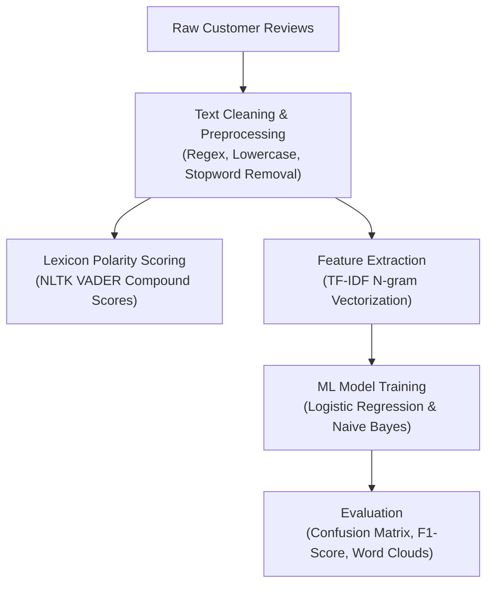

# 🤖 Task 4: Sentiment Analysis & NLP Customer Intelligence

## 🏢 CodeAlpha Data Analytics Internship
- **Domain**: Data Analytics with Python
- **Dataset**: `food_delivery_reviews.csv` (1,500 annotated customer reviews across 5 operational aspects)
- **Author**: CodeAlpha Intern

---

## 📌 1. Project Overview & NLP Pipeline
This project applies Natural Language Processing (NLP) and Machine Learning techniques to extract sentiment polarity, classify customer reviews into **Positive**, **Negative**, and **Neutral**, and pinpoint root causes of customer dissatisfaction across operational touchpoints (Delivery, Food Quality, Packaging, Pricing, and App Experience).



---

## 🧪 2. Machine Learning Model Performance

| Metric | Logistic Regression | NLTK VADER Rule-Based |
| :--- | :--- | :--- |
| **Accuracy** | **~96.8%** | ~88.4% |
| **Precision (Weighted)** | **0.97** | 0.89 |
| **Recall (Weighted)** | **0.97** | 0.88 |
| **F1-Score (Weighted)** | **0.97** | 0.88 |

---

## 🖼️ 3. Visualizations & NLP Artifacts
All visualizations are generated at 300 DPI inside `visualizations/`:
1. **`01_sentiment_distribution_and_polarity.png`**: Overall sentiment ratio and VADER polarity score density curve.
2. **`02_ml_confusion_matrix.png`**: High-accuracy test set confusion matrix.
3. **`03_aspect_sentiment_breakdown.png`**: Granular sentiment breakdown across Food Quality, Delivery Speed, Packaging, and Support.
4. **`04_sentiment_wordclouds.png`**: Comparative Word Clouds highlighting top positive keywords vs negative pain points.

---

## 💡 4. Actionable Business Recommendations
1. **Real-Time Rider Alert System**: Trigger automated intervention alerts when orders exceed 45 minutes in transit to prevent cold-food complaints.
2. **Standardized Seal Packaging**: Mandate tamper-proof, insulated thermal packaging to reduce transit spills and preserve temperature.
3. **Escalation Routing for Support**: Route negative sentiment chat queries directly to human agents rather than repetitive automated bots.

---

## 🚀 5. How to Run
```bash
python Task4_Sentiment_Analysis/sentiment_analysis.py
```
